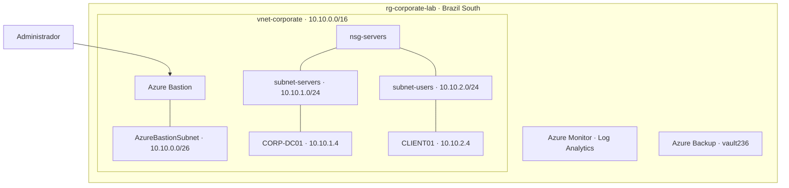

# Azure Infrastructure Lab

Ambiente de estudo de **Infraestrutura no Microsoft Azure**, organizado por área de configuração.

[Recursos](#recursos-do-laboratório) · [Rede](#rede) · [Servidor](#servidor-e-acesso) · [Domínio](#active-directory-e-dns) · [Cliente](#cliente-no-domínio) · [Monitoramento](#monitoramento) · [Backup](#backup)

## Recursos do laboratório

Os componentes foram reunidos no grupo `rg-corporate-lab`, na região **Brazil South**, com marcações de ambiente e projeto.

## Rede

A rede `vnet-corporate` (`10.10.0.0/16`) foi dividida por função:

| Sub-rede | Endereço | Uso |
| --- | --- | --- |
| `AzureBastionSubnet` | `10.10.0.0/26` | Acesso administrativo |
| `subnet-servers` | `10.10.1.0/24` | Servidor |
| `subnet-users` | `10.10.2.0/24` | Cliente |

O `nsg-servers` foi associado às sub-redes de servidores e usuários, utilizando as regras padrão do Azure.

## Servidor e acesso

Foi criada a VM `vm-server` com **Windows Server 2025 Datacenter**, nome Windows `CORP-DC01` e IP privado `10.10.1.4`. O IP público do servidor foi removido e o acesso administrativo passou a utilizar o **Azure Bastion**.

## Active Directory e DNS

No `CORP-DC01`, foram configurados **AD DS e DNS integrado**, com o domínio `corp.local`. A estrutura do diretório inclui unidades para computadores, servidores, grupos e usuários.

O diagnóstico DNS confirmou o controlador `CORP-DC01.corp.local` e os registros de localização do domínio.

## Cliente no domínio

A VM **CLIENT01**, com Windows 11 Pro e IP `10.10.2.4`, recebeu o DNS `10.10.1.4` e foi associada a `corp.local`.

**Verificações:** associação ao domínio, resolução DNS, conexão LDAP na porta 389 e canal seguro com resultado `True`.

## Identidade híbrida

O **Microsoft Entra Cloud Sync** provisionou o usuário de laboratório `pedro.silva` do Active Directory para o Microsoft Entra ID. O teste individual sob demanda confirmou importação, escopo, correspondência e criação da identidade na nuvem. A sincronização periódica permanece desabilitada.

## Monitoramento

Foram configurados o **Azure Monitor Agent**, o workspace `law-corporate`, a regra de coleta de dados e alertas de consumo e disponibilidade, associados a um Action Group.

[Consultar componentes de monitoramento](docs/servicos.md#monitoramento)

## Backup

As VMs foram incluídas no cofre **vault236**. A captura registra o backup do servidor com resultado **Êxito** e ponto de restauração disponível.

**Recuperação testada:** disco do sistema restaurado a partir do backup, com 127 GiB, em um grupo separado. A VM original foi preservada. O teste confirma a recuperação do disco; não inclui inicialização de uma VM restaurada.

## Visão da arquitetura

[Infraestrutura](docs/infraestrutura.md) · [Serviços e verificações](docs/servicos.md) · [Todas as capturas](screenshots/README.md)

---

**Pedro Henrique da Silva** · Laboratório de estudo · [Licença MIT](LICENSE)
