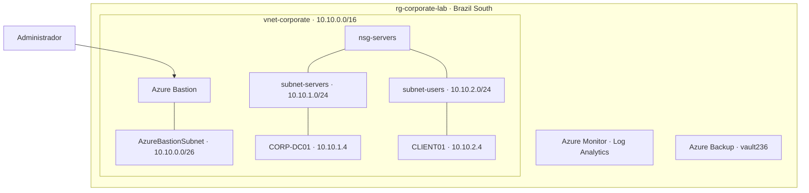
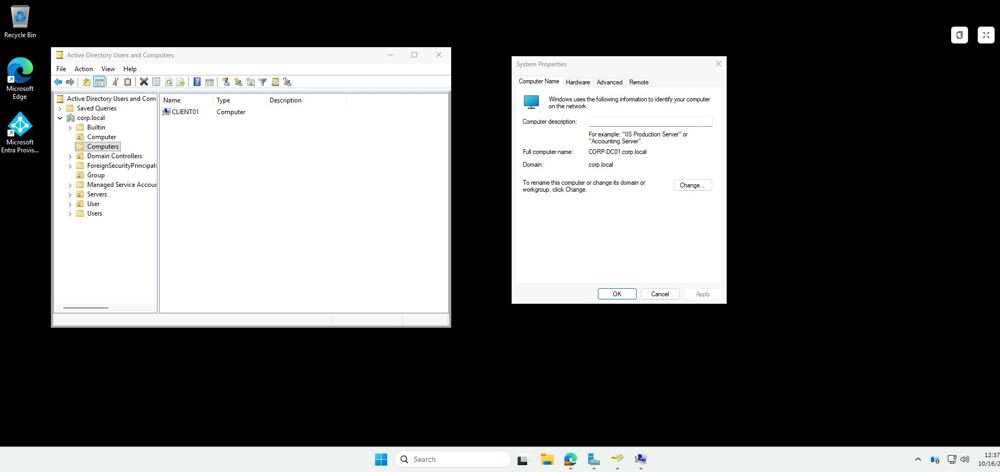
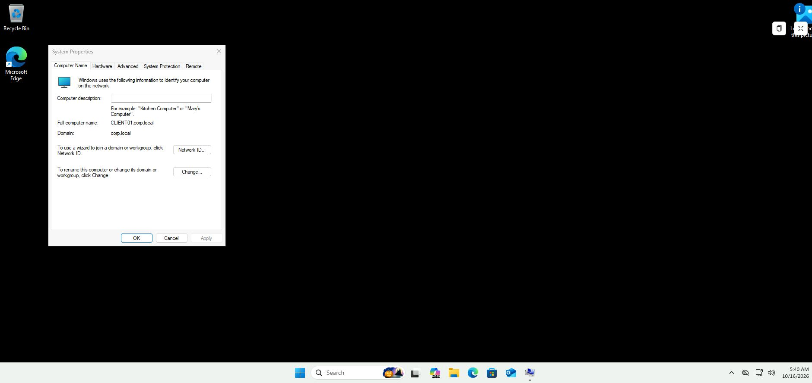
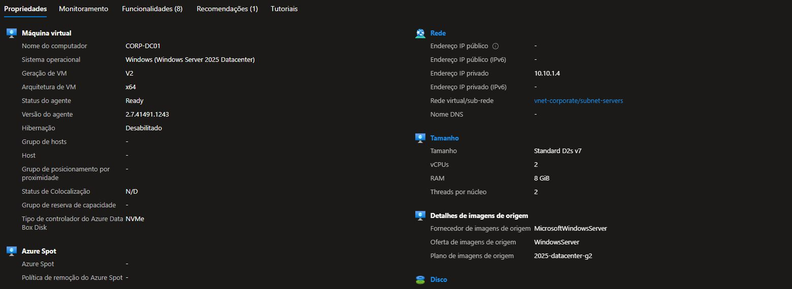
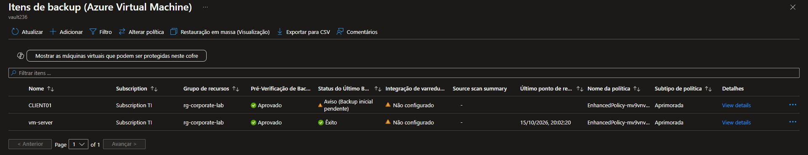

# Azure Infrastructure Lab

Ambiente de estudo de **Infraestrutura no Microsoft Azure**, reunindo rede, servidores Windows, identidade, monitoramento e backup.

## Visão geral

| Área | Estrutura implementada |
| --- | --- |
| Rede | VNet com sub-redes para servidores, usuários e Bastion |
| Servidor | Windows Server 2025 — `CORP-DC01`, IP privado `10.10.1.4` |
| Cliente | Windows 11 Pro — `CLIENT01`, IP privado `10.10.2.4` |
| Identidade | AD DS e DNS configurados para `corp.local` |
| Acesso | Azure Bastion; VMs sem IP público |
| Monitoramento | Azure Monitor Agent, Log Analytics, DCR e regras de alerta |
| Backup | Recovery Services Vault; backup do servidor com êxito |

## Arquitetura

Diagrama de organização dos componentes do laboratório.

## Evidências do ambiente

### Windows Server e Active Directory

Sessão da VM acessada pelo Azure Bastion, com o domínio `corp.local`, a conta de computador `CLIENT01` no Active Directory e a identificação `CORP-DC01.corp.local` nas propriedades do Windows.

### Cliente no domínio

A CLIENT01 está associada a `corp.local`. Em 16/10/2026, o teste de canal seguro retornou `True`, a consulta DNS localizou o controlador e a conexão LDAP foi bem-sucedida.

### Servidor com endereço privado

Windows Server 2025, nome `CORP-DC01` e ausência de IP público registrados no portal.

### Backup do servidor

Último backup do `vm-server` com resultado **Êxito** e ponto de restauração disponível na captura.

[Ver rede e demais capturas →](screenshots/README.md)

## Documentação

[Infraestrutura](docs/infraestrutura.md) · [Serviços](docs/servicos.md)

---

**Pedro Henrique da Silva** · Laboratório de estudo · [Licença MIT](LICENSE)
