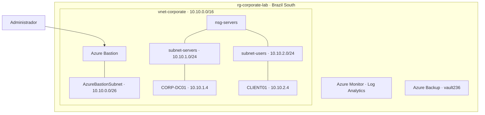

# Azure Infrastructure Lab

Passo a passo da configuração de um ambiente de estudo no **Microsoft Azure**, da rede ao domínio Windows e ao backup.

**Sequência:** Recursos → Rede → Servidor e acesso → Active Directory → Cliente → Monitoramento → Backup

## 1. Organização dos recursos

Os componentes foram reunidos no grupo `rg-corporate-lab`, na região **Brazil South**, com marcações de ambiente e projeto.

Ver recursos no portal

## 2. Configuração da rede

A rede `vnet-corporate` (`10.10.0.0/16`) foi dividida por função:

| Sub-rede | Endereço | Uso |
| --- | --- | --- |
| `AzureBastionSubnet` | `10.10.0.0/26` | Acesso administrativo |
| `subnet-servers` | `10.10.1.0/24` | Servidor |
| `subnet-users` | `10.10.2.0/24` | Cliente |

O `nsg-servers` foi associado às sub-redes de servidores e usuários, utilizando as regras padrão do Azure.

Ver sub-redes e regras de segurança

## 3. Servidor e acesso administrativo

Foi criada a VM `vm-server` com **Windows Server 2025 Datacenter**, nome Windows `CORP-DC01` e IP privado `10.10.1.4`. O IP público do servidor foi removido e o acesso administrativo passou a utilizar o **Azure Bastion**.

Ver propriedades da VM

## 4. Active Directory e DNS

No `CORP-DC01`, foram configurados **AD DS e DNS integrado**, com o domínio `corp.local`. A estrutura do diretório inclui unidades para computadores, servidores, grupos e usuários.

O diagnóstico DNS confirmou o controlador `CORP-DC01.corp.local` e os registros de localização do domínio.

Ver sessão do Windows Server pelo Bastion

## 5. Cliente associado ao domínio

A VM **CLIENT01**, com Windows 11 Pro e IP `10.10.2.4`, recebeu o DNS `10.10.1.4` e foi associada a `corp.local`.

**Verificado em 16/10/2026:** associação ao domínio, resolução DNS, conexão LDAP na porta 389 e canal seguro com resultado `True`.

Ver sessão do cliente no domínio

## 6. Estrutura de monitoramento

Foram configurados o **Azure Monitor Agent**, o workspace `law-corporate`, a regra de coleta de dados e alertas de consumo e disponibilidade, associados a um Action Group.

[Consultar componentes de monitoramento](docs/servicos.md#monitoramento)

## 7. Proteção por backup

As VMs foram incluídas no cofre **vault236**. A captura registra o backup do servidor com resultado **Êxito** e ponto de restauração disponível.

Ver itens de backup no Azure

## Visão da arquitetura

[Infraestrutura](docs/infraestrutura.md) · [Serviços e verificações](docs/servicos.md) · [Todas as capturas](screenshots/README.md)

---

**Pedro Henrique da Silva** · Laboratório de estudo · [Licença MIT](LICENSE)
