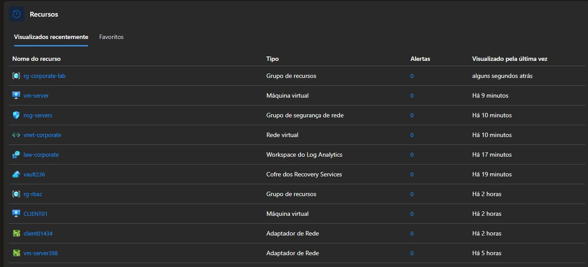
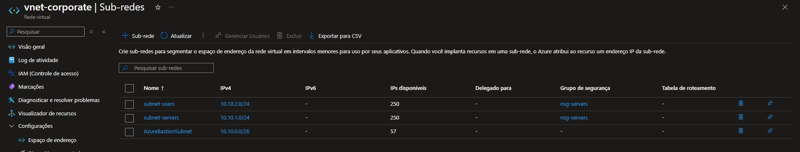
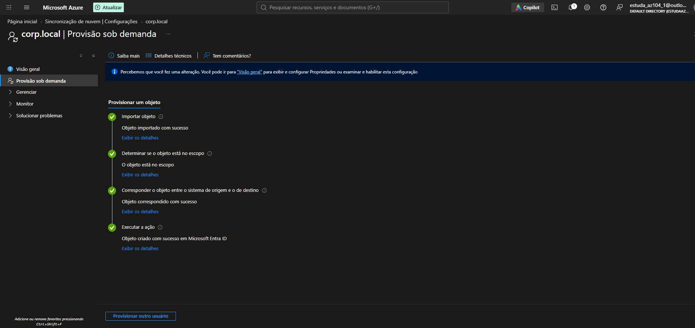
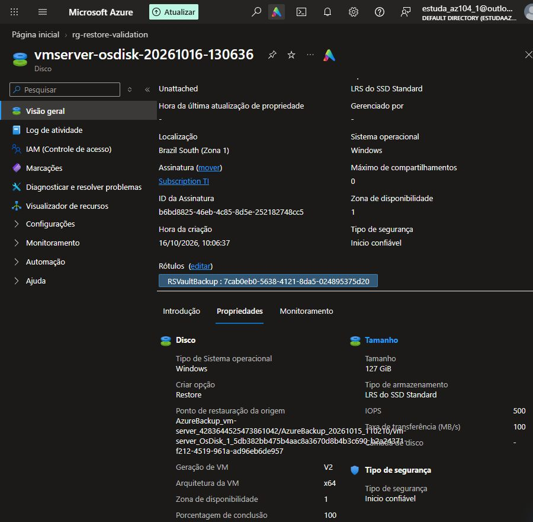

# Azure Infrastructure Lab

Criei este laboratório para colocar em prática meus estudos de **infraestrutura no Microsoft Azure**. A ideia foi montar um ambiente com serviços comuns na rotina de TI: rede, servidor Windows, domínio, acesso remoto, monitoramento e backup.

Aqui reuni o que configurei, com uma explicação curta de cada parte e capturas do ambiente.

[Recursos](#recursos-do-laboratório) · [Rede](#rede) · [Servidor](#servidor-e-acesso) · [Domínio](#active-directory-e-dns) · [Cliente](#cliente-no-domínio) · [Monitoramento](#monitoramento) · [Backup](#backup) · [Ajustes](docs/ajustes-do-ambiente.md)

## Recursos do laboratório

Organizei os recursos no grupo `rg-corporate-lab`, na região **Brazil South**. Assim, fica mais fácil encontrar os componentes e acompanhar o ambiente em um só lugar.

## Rede

Na rede `vnet-corporate`, separei os endereços por função: uma sub-rede para o servidor, outra para o cliente e uma dedicada ao Bastion.

| Sub-rede | Endereço | Uso |
| --- | --- | --- |
| `AzureBastionSubnet` | `10.10.0.0/26` | Acesso administrativo |
| `subnet-servers` | `10.10.1.0/24` | Servidor |
| `subnet-users` | `10.10.2.0/24` | Cliente |

Associei o `nsg-servers` às sub-redes de servidores e usuários. Para o acesso remoto, liberei a porta 3389 somente para a sub-rede do Bastion e mantive o bloqueio para as demais origens.

## Servidor e acesso

O servidor roda **Windows Server 2025 Datacenter**. No Azure, o recurso se chama `vm-server`; dentro do Windows, usei o nome `CORP-DC01` e o IP privado `10.10.1.4`.

Para administrá-lo, configurei o **Azure Bastion**, que permite abrir a sessão pelo portal sem manter um IP público na VM.

## Active Directory e DNS

Configurei o **Active Directory e o DNS** no `CORP-DC01`, criando o domínio `corp.local`. Também organizei o diretório em unidades para computadores, servidores, grupos e usuários.

O teste de DNS confirmou os registros usados para localizar o controlador do domínio.

## Cliente no domínio

A **CLIENT01** representa uma estação de trabalho, com Windows 11 Pro e IP `10.10.2.4`. Apontei o DNS para o servidor e incluí a máquina no domínio `corp.local`.

Para conferir a comunicação com o domínio, foram testados o DNS, a conexão LDAP e o canal seguro entre cliente e servidor. Todos esses testes passaram.

## Identidade híbrida

Também testei a ligação entre o Active Directory e o **Microsoft Entra ID**. Com o Cloud Sync, o usuário de laboratório `pedro.silva` foi criado na nuvem a partir do diretório local.

Foi um teste individual sob demanda; a sincronização automática permanece desabilitada.

## Monitoramento

Montei a estrutura com **Azure Monitor Agent**, workspaces e alertas. A regra de coleta do servidor envia métricas para o Azure Monitor Workspace `defaultazuremonitorworkspace-cq`; o Log Analytics `law-corporate` é um recurso separado. Também conferi a extensão e os processos do agente no servidor.

[Consultar componentes de monitoramento](docs/servicos.md#monitoramento)

## Backup

Incluí as VMs no cofre **vault236**. O backup do servidor foi concluído com êxito, deixando um ponto de recuperação disponível.

Para ir além do backup salvo, testei a recuperação do disco Windows de **127 GiB** em um grupo separado, preservando o servidor original. O teste terminou com o disco recuperado e desanexado, sem iniciar uma nova VM.

## Ajustes no ambiente

Depois de montar o laboratório, revisei o acesso pelo Bastion, a rota de saída e a conexão privada ao armazenamento. Também conferi DNS, identidade e monitoramento.

[Ver os ajustes, um assunto por vez, com capturas](docs/ajustes-do-ambiente.md)

## Visão da arquitetura

[Infraestrutura](docs/infraestrutura.md) · [Serviços e verificações](docs/servicos.md) · [Ajustes no ambiente](docs/ajustes-do-ambiente.md) · [Todas as capturas](screenshots/README.md)

---

**Pedro Henrique da Silva** · Laboratório de estudo · [Licença MIT](LICENSE)
