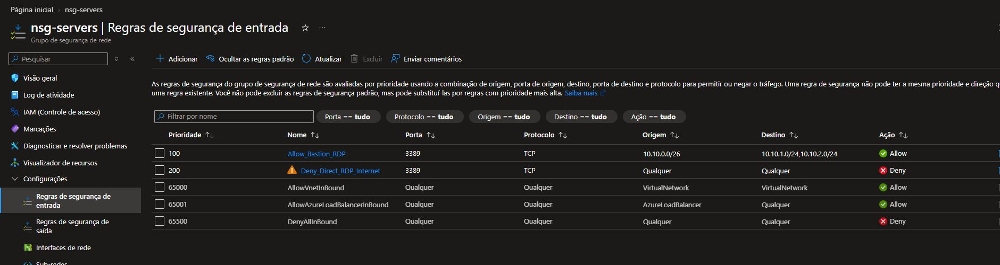
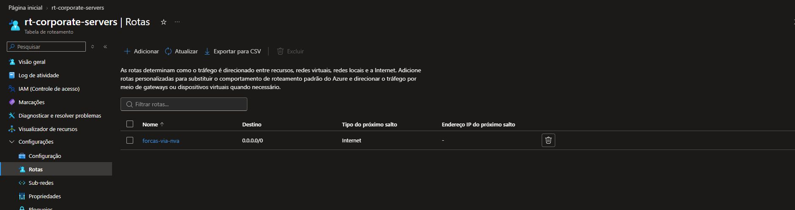
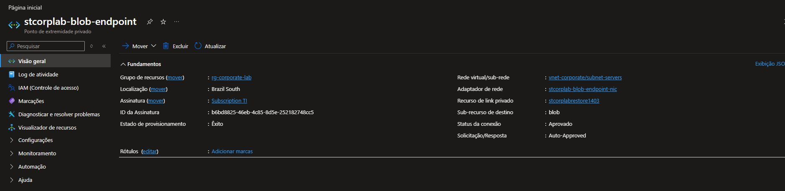

# Ajustes no ambiente

Com o laboratório montado, revisei a comunicação entre os recursos e o acesso ao servidor. Abaixo, cada assunto tem sua própria explicação e as capturas principais.

## 1. Acesso pelo Bastion

No `nsg-servers`, deixei o RDP do servidor e do cliente acessível somente a partir da sub-rede do Bastion. As VMs continuam sem IP público.

| Prioridade | Regra | Resultado |
| --- | --- | --- |
| 100 | `Allow_Bastion_RDP` | Permite TCP 3389 de `10.10.0.0/26` para as sub-redes de servidores e usuários |
| 200 | `Deny_Direct_RDP_Internet` | Bloqueia TCP 3389 para as demais origens |

## 2. Saída da sub-rede de servidores

Ajustei a rota padrão da tabela `rt-corporate-servers` para usar **Internet** como próximo salto. A tabela continua associada à sub-rede de servidores.

O nome da rota foi mantido como `forcas-via-nva`; seu próximo salto atual é **Internet**. Na conferência do servidor, a conexão HTTPS com `login.microsoftonline.com` passou.

## 3. Armazenamento pela rede privada

Conferi o acesso ao Blob Storage pelo endpoint privado `stcorplab-blob-endpoint`, com IP `10.10.1.5`. O nome da conta resolve para esse endereço pela zona `privatelink.blob.core.windows.net`.

No servidor, a resolução DNS e a conexão à porta **443** passaram. Assim, o acesso testado ao armazenamento usa o endereço privado dentro da rede.

## 4. DNS e domínio

Conferi os serviços DNS e Active Directory e os registros usados para localizar o domínio `corp.local`. O controlador identificado foi o `CORP-DC01`, no IP `10.10.1.4`.

O DNS do servidor já usava o encaminhador `168.63.129.16`, por isso mantive essa configuração. O teste anterior da CLIENT01 também confirmou a associação ao domínio e o canal seguro.

[Ver o cliente no domínio](../README.md#cliente-no-domínio)

## 5. Identidade e monitoramento

No servidor, iniciei o serviço do **Entra Cloud Sync** e ajustei sua partida para automática com atraso. A sincronização periódica continua desabilitada; o teste do projeto foi o provisionamento individual do usuário de laboratório.

Também conferi a extensão **Azure Monitor Agent** e seus processos. A regra de coleta aponta para o Azure Monitor Workspace `defaultazuremonitorworkspace-cq`, separado do Log Analytics `law-corporate`.

[Ver componentes e resultados dos testes](servicos.md)

## 6. Proteção e encerramento dos testes

Mantive o bloqueio contra exclusão do grupo `rg-corporate-lab` e os bloqueios específicos do cofre de backup e do Log Analytics. Ao encerrar os testes, deixei a CLIENT01 e o servidor **desalocados** para interromper a cobrança de processamento das VMs.

Discos, Bastion e outros recursos mantidos têm cobrança própria.

[Voltar ao projeto](../README.md) · [Ver todas as capturas](../screenshots/README.md)
