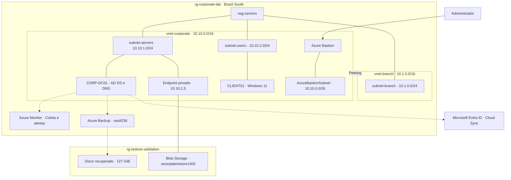

# Projeto Azure

Reuni nesta página o que configurei no laboratório, com uma explicação curta e as capturas de cada parte. A leitura começa pela base da infraestrutura e segue até os serviços e os ajustes de rede.

[Visão geral](#1-visão-geral) · [Rede](#2-rede-e-acesso) · [Domínio](#3-servidor-e-domínio) · [Cliente](#4-cliente-no-domínio) · [Identidade](#5-identidade-híbrida) · [Monitoramento](#6-monitoramento) · [Backup](#7-backup-e-recuperação) · [Armazenamento](#8-armazenamento-privado) · [Filial](#9-rede-de-filial)

## 1. Visão geral

Usei o grupo `rg-corporate-lab`, em **Brazil South**, para organizar a infraestrutura principal. O servidor e a estação ficam em sub-redes separadas, sem IP público nas VMs.

### Arquitetura do ambiente

O desenho reúne a estrutura descrita nesta página. As capturas registram partes do ambiente ao longo da configuração; a visão de recursos acima não representa um inventário completo.

## 2. Rede e acesso

Separei o endereçamento por função para organizar os servidores, as estações e o acesso administrativo.

| Rede | Endereço | Finalidade |
| --- | --- | --- |
| `vnet-corporate` | `10.10.0.0/16` | Rede corporativa |
| `AzureBastionSubnet` | `10.10.0.0/26` | Acesso pelo Bastion |
| `subnet-servers` | `10.10.1.0/24` | Servidores |
| `subnet-users` | `10.10.2.0/24` | Estações |

### Acesso administrativo

O acesso às VMs passa pelo `bastion-corporate`. O IP público `vnet-corporate-IPv4` pertence a esse acesso, e não às máquinas.

No `nsg-servers`, ajustei as regras para permitir RDP da sub-rede do Bastion às sub-redes corporativas de servidores e usuários.

| Prioridade | Regra | Configuração |
| --- | --- | --- |
| 100 | `Allow_Bastion_RDP` | TCP 3389 de `10.10.0.0/26` para `10.10.1.0/24` e `10.10.2.0/24` |
| 200 | `Deny_Direct_RDP_Internet` | Nega TCP 3389 nas demais combinações de origem e destino |

### Saída dos servidores

Associei a tabela `rt-corporate-servers` à `subnet-servers`. A rota `0.0.0.0/0` usa **Internet** como próximo salto e mantém o nome `forcas-via-nva`.

No servidor, a conexão HTTPS com `login.microsoftonline.com` passou no teste.

## 3. Servidor e domínio

Configurei o Windows Server com **AD DS e DNS** para o domínio `corp.local`. No Active Directory, organizei unidades para computadores, servidores, usuários e grupos.

| Item | Configuração |
| --- | --- |
| Recurso no Azure | `vm-server` |
| Nome no Windows | `CORP-DC01` |
| Sistema | Windows Server 2025 Datacenter |
| Tamanho | Standard D2s v7 |
| IP privado | `10.10.1.4` |

Nos testes, os serviços de AD DS e DNS estavam em execução. O diagnóstico `dcdiag /test:dns` passou, e os registros SRV localizaram o controlador em `10.10.1.4`. O encaminhador DNS usado no servidor é `168.63.129.16`.

## 4. Cliente no domínio

Incluí a **CLIENT01**, com Windows 11 Pro, no domínio `corp.local`. A estação usa o DNS `10.10.1.4`, configurado na VNet corporativa, para localizar o servidor.

| Item | Configuração ou resultado |
| --- | --- |
| Tamanho | Standard F2-1amds v7 |
| IP privado | `10.10.2.4` |
| Associação ao domínio | `PartOfDomain: True` |
| LDAP | TCP 389 acessível no servidor |
| Canal seguro | `Test-ComputerSecureChannel`: `True` |

Os IPs das duas VMs são os endereços registrados no ambiente; as interfaces estão configuradas com alocação privada dinâmica.

## 5. Identidade híbrida

Usei o **Entra Cloud Sync** para provisionar o usuário de laboratório `pedro.silva` do AD para o Microsoft Entra ID. O teste individual sob demanda terminou com a criação da identidade na nuvem.

Também iniciei o serviço `AADConnectProvisioningAgent` no servidor e configurei sua inicialização como automática com atraso. O teste cobre o provisionamento do usuário; login e sincronização de senha não fizeram parte dessa validação. A sincronização periódica permanece desabilitada.

## 6. Monitoramento

Configurei o agente, a regra de coleta e os alertas para acompanhar o servidor.

| Componente | Configuração |
| --- | --- |
| Agente | `AzureMonitorWindowsAgent` |
| Regra de coleta | `msvmi-brazilsouth-vm-server` |
| Destino de métricas | Azure Monitor Workspace `defaultazuremonitorworkspace-cq` |
| Log Analytics | `law-corporate`, workspace separado |
| Alerta de CPU | `Alerta-CPU-Alta-Server`: média acima de 80% em 5 minutos |
| Outros alertas | `Virtual Machine Consumption` e `VM Availability - vm-server` |
| Grupo de ações | `VMI-ActionGroup-vm-server` |

Na conferência local, a extensão do agente apresentou sucesso e seus processos estavam em execução. Essa verificação corresponde ao agente no servidor, sem comprovar a chegada de dados aos workspaces ou o disparo dos alertas.

## 7. Backup e recuperação

Configurei a proteção no cofre **vault236**, com a política `EnhancedPolicy-mv9vnv6q`. O backup do servidor terminou com êxito e disponibilizou um ponto de recuperação.

Em seguida, recuperei o disco Windows de **127 GiB** no grupo `rg-restore-validation`, mantendo a VM original preservada. O disco ficou com origem **Restore** e referência ao backup utilizado.

O teste terminou na recuperação do disco; não foi iniciada uma VM a partir dele.

## 8. Armazenamento privado

Configurei o endpoint `stcorplab-blob-endpoint` na sub-rede de servidores para acessar o Blob Storage da conta `stcorplabrestore1403`, que fica no grupo `rg-restore-validation`.

- **IP privado:** `10.10.1.5`.
- **Zona DNS:** `privatelink.blob.core.windows.net`, vinculada à VNet corporativa.
- **Conferência no servidor:** resolução do nome para o IP privado e conexão TCP 443 aprovadas.

## 9. Rede de filial

O ambiente também conta com uma segunda rede virtual, conectada à rede corporativa por **VNet Peering**.

| Item | Configuração |
| --- | --- |
| Rede da filial | `vnet-branch` — `10.1.0.0/16` |
| Sub-rede | `subnet-branch` — `10.1.0.0/24` |
| Conexão | Peering nos dois sentidos com `vnet-corporate` |
| Estado registrado no template | `Connected` e `FullyInSync` |
| Segurança | `nsg-servers` associado também à `subnet-branch` |

O peering permite acesso entre as redes virtuais, sujeito às regras de rede e dos sistemas. As permissões de encaminhamento de tráfego e de trânsito por gateway estão desabilitadas.

A regra personalizada de RDP pelo Bastion continua destinada às sub-redes corporativas `10.10.1.0/24` e `10.10.2.0/24`; ela não inclui a sub-rede da filial. O estado do peering foi conferido no template exportado, sem teste de comunicação entre máquinas da filial e da matriz.

## Proteção dos recursos

O grupo corporativo possui bloqueio contra exclusão. O cofre de backup e o Log Analytics também têm bloqueios específicos.

Ao encerrar os testes, deixei servidor e cliente desalocados. Discos, Bastion e outros recursos mantidos têm cobrança própria.

[Voltar à apresentação do projeto](../README.md)
